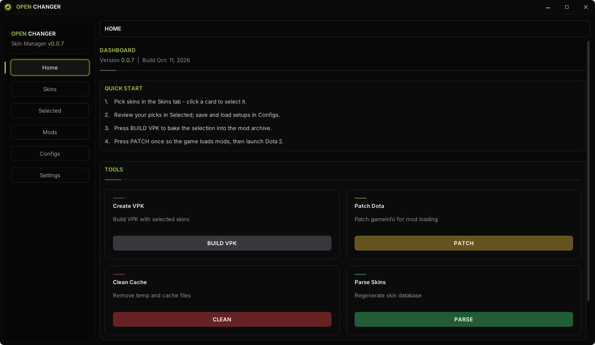
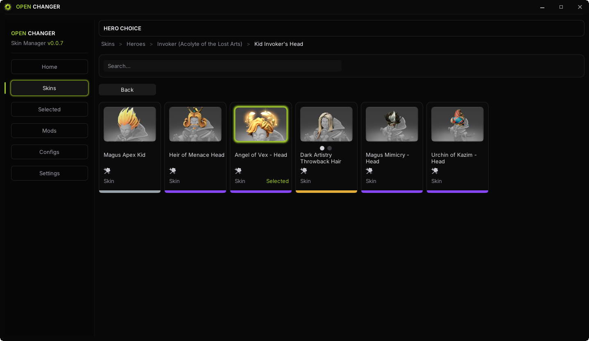
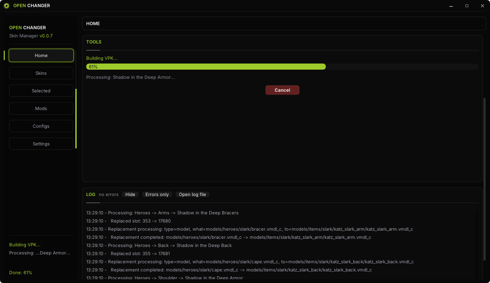

# OpenChanger — skin changer для Dota 2

<div align="center">

**Все скины Dota 2. Бесплатно.**

[](https://github.com/lighthurtsmyeyes/openchanger-website/releases)
[](https://github.com/lighthurtsmyeyes/openchanger-website/stargazers)
[](https://github.com/lighthurtsmyeyes/openchanger-website/releases)

[🌐 Сайт](https://lighthurtsmyeyes.github.io/openchanger-website/) · [⬇️ Скачать](https://github.com/lighthurtsmyeyes/openchanger-website/releases/download/Release/OpenChanger-x64-Windows.zip) · [💬 Discord](https://discord.gg/invite/PHWW2QDJJN)

</div>

---

## 🇷🇺 Русский

Бесплатный скинченжер для Dota 2 с открытым кодом: 12 000+ скинов на всех 125 героев — арканы, имморталы, редкие курьеры. Выбрал скин, нажал Build и Patch — и играешь с ним. Без рекламы, подписок и премиум-версий.

### Как это работает

1. **Скачай** — один портативный архив, без установщика: [последний релиз](https://github.com/lighthurtsmyeyes/openchanger-website/releases/download/Release/OpenChanger-x64-Windows.zip).
2. **Выбери скины** — поиск по герою, фильтры по редкости.
3. **Build** — программа соберёт пак из выбранных скинов.
4. **Patch** — пропатчит клиент Dota 2.
5. **Запусти Dota 2** — скины в игре. Видишь их только ты.

### Скриншоты

| Главный экран | Выбор скинов |
|---|---|
|  |  |

| Патчинг |
|---|
|  |

### Частые вопросы

- **Это бесплатно?** Да, полностью и навсегда.
- **Скины видят другие игроки?** Нет — замена только в твоём клиенте.
- **Могут забанить?** Методу VPK-замены ~9 лет, задокументированных банов не было. Сервер о скинах ничего не знает.
- **Нужен логин Steam?** Нет. Программа вообще не взаимодействует со Steam.

Полные ответы — на [сайте в разделе FAQ](https://lighthurtsmyeyes.github.io/openchanger-website/#faq) и в гайдах:

- [Скинченжер Dota 2 — что это и безопасно ли?](https://lighthurtsmyeyes.github.io/openchanger-website/guides/skin-changer-dota-2.html)
- [Как поменять скины в Dota 2 — гайд 2026](https://lighthurtsmyeyes.github.io/openchanger-website/guides/kak-pomenyat-skiny-dota-2.html)
- [Все арканы Dota 2 — посмотреть в игре бесплатно](https://lighthurtsmyeyes.github.io/openchanger-website/guides/arcany-dota-2.html)

### Связь

Вопросы, баги, идеи — [наш Discord](https://discord.gg/invite/PHWW2QDJJN). Поставь ⭐ репозиторию, если программа понравилась.

---

## 🇬🇧 English

A free, open-source Dota 2 skin changer: 12,000+ skins for all 125 heroes — arcanas, immortals, rare couriers. Pick a skin, hit Build and Patch — and play with it. No ads, no subscriptions, no premium tiers.

### How it works

1. **Download** — a single portable archive, no installer: [latest release](https://github.com/lighthurtsmyeyes/openchanger-website/releases/download/Release/OpenChanger-x64-Windows.zip).
2. **Pick your skins** — search by hero, filter by rarity.
3. **Build** — the app packs your selection.
4. **Patch** — it patches the Dota 2 client.
5. **Launch Dota 2** — the skins are in. Only you can see them.

### FAQ

- **Is it free?** Yes, completely, forever.
- **Can other players see the skins?** No — the swap is local to your client.
- **Can I get banned?** VPK replacement has been around for ~9 years with no documented bans. The server knows nothing about your skins.
- **Does it need my Steam login?** No. The app never touches Steam.

Full answers on the [website FAQ](https://lighthurtsmyeyes.github.io/openchanger-website/#faq).

### Community

Questions, bugs, ideas — [join our Discord](https://discord.gg/invite/PHWW2QDJJN). Drop a ⭐ if you like the project.

---

## 🛠 Сайт / Website

This repository also hosts the project website (React + Vite + Tailwind), deployed to GitHub Pages:

```bash
npm install
npm run dev      # local dev server
npm run build    # production build → dist/
```

> OpenChanger не аффилирован с Valve Corporation. Dota 2 является торговой маркой Valve Corporation. Программа предоставляется «как есть».
>
> OpenChanger is not affiliated with Valve Corporation. Dota 2 is a trademark of Valve Corporation. The software is provided "as is".
